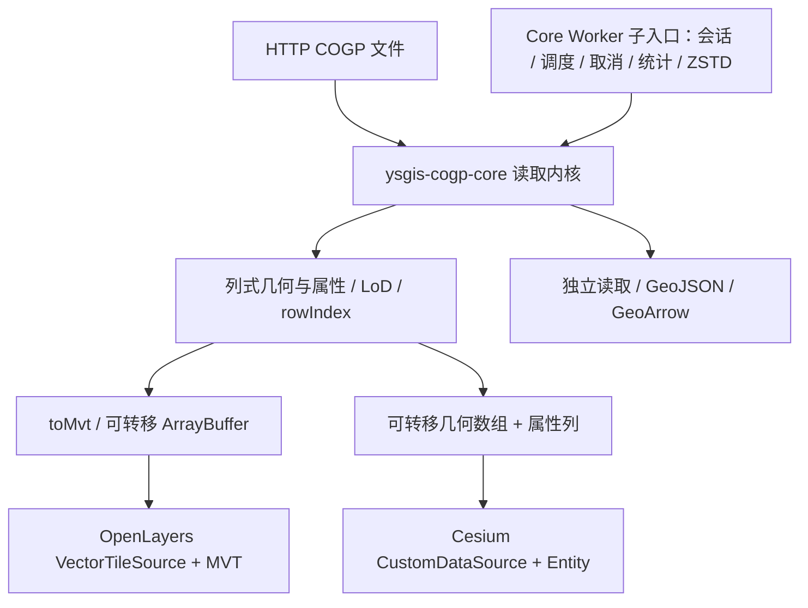

# ysgis-cogp-core / openlayers / cesium 设计与实施计划

日期：2026-11-18。状态：三包 MVP 已实现并验证。具体公开 API 以各包 README 和源码声明为准；本文件保留架构依据及后续增强计划。

## 1. 目标与边界

在 `ysgis-cogp-core/` 中提供独立读取内核，在 `ysgis-cogp-openlayers/` 和 `ysgis-cogp-cesium/` 中提供引擎扩展。三个包均可独立发布；从 HTTP(S) 地址按空间范围和显示分辨率读取 COGP，在浏览器完成解码和渲染，无需新增瓦片服务器。

- 面向原生 `ol` 与 `cesium`，不依赖 Vue、Quasar、xgis-ol 或 Mars3D；业务框架可在外层接入。
- Core 是格式读取内核和跨引擎运行时的唯一实现：它替换 `@cogp/reader`，承接 Reader 的 Parquet/GeoParquet/COGP 解码、Range、page index、bbox、LoD、overview 和编码能力，并增加 Worker、并发、取消、统计、瓦片/批次请求和传输。三包统一通过 Core。源码承接、兼容 API、同步策略和迁移计划详见 [Core 专项设计](./ysgis-cogp-core/DESIGN.md)。
- 第一版支持 Point、MultiPoint、LineString、MultiLineString、Polygon、MultiPolygon；GeometryCollection 不在上游当前解码支持范围内。
- Core 读取带有效 `geo.lod` 的 COGP；没有 `geo.lod` 的普通 GeoParquet 在当前 Reader 和适配器中均明确拒绝。数据转换/写入、SQL 查询、3D Tiles 生成不列入第一版。
- 已实现 Core、OpenLayers、Cesium、MapLibre、Mars3D 五包，生成本地测试 tarball；未发布 npm。Mars3D 适配器复用 Core runtime，以 `GraphicLayer` 管理 `PointEntity`、`PolylineEntity` 和 `PolygonEntity`。

## 2. 调查依据

首次调查时三个引擎目标目录均为空，无现成 package/workspace/build/test 配置，也未找到适用的 AGENTS.md。本次新增 Core 目录及专项设计，尚未实现任何包。

参考目录：`D:\学习资料\cloud-optimized-geoparquet\js\packages\reader`（读取内核）与同级 `maplibre`（Worker 与瓦片适配）。

| 参考模块 | 已确认职责 | 对新扩展的意义 |
|---|---|---|
| `src/index.ts` | 注册 MapLibre 专用 protocol，提供 inspect/stats | 借鉴能力，不复制引擎专用 protocol 接口 |
| `src/url.ts` | 多逻辑层配置、字段映射、瓦片坐标校验 | 借鉴输入校验；新包无需把全部配置编码进 URL |
| `src/tile.ts` | tile bbox → LoD → read → toMvt | 直接适用于 OpenLayers 的 Web Mercator MVT 路线 |
| `src/worker-client.ts` | 请求 ID、Promise、AbortSignal、Worker 错误 | 抽出公共通信模型，补充实例所有权与释放 |
| `src/worker.ts` | ZSTD、Reader LRU、统计、取消 | 借鉴，补充资源预算和请求调度 |
| `test/adapter.test.mjs` | 配置、MVT、多文件、mock Worker | 保留对应契约测试，补充引擎与真实浏览器验收 |

本地参考 `@cogp/maplibre` / `@cogp/reader` package.json 标记版本均为 2.1.4，Git HEAD 为 `44f29be34d303fbb1febb154413a5aa7aa568a91`，本次检查未见源码工作区改动。实施记录源码清单与哈希，锁定实际使用的压缩/裁剪依赖；不把外部学习目录绝对路径写入发布产物。

Reader 的 `vendor/hyparquet` 是带 `onColumnView` 和 page planning 能力的 fork；其 README 标记 commit `9365a88f34a0816b9a77e08c176ca0c480d3524c`。Core 必须携带这些内部模块及声明文件，并以同步基线维护；若升级 fork，必须保留 JS、声明、许可、来源和完整回归测试，不能直接替换成未经验证的普通 npm hyparquet。

### 上游数据契约

1. `selectLevel(resolution)` 的单位是主几何 CRS 单位/像素，不是直接传 zoom 或 Cesium 相机高度。
2. LoD 选择累计 row-group 前缀；细层包含粗层要素。不同层可能只更换 overview，行数不变，因此不能仅按 ID 集合判断几何无需更新。
3. `read({ bbox, maxLevel, columns, useOverview, maxRows, signal })` 返回 `CogpBatch`，包含稳定的文件行号 `rowIndex`、属性列与 `GeometryColumn`。
4. bbox 是主几何包围盒筛选，不是精确相交查询；没有统计/covering 时读取范围可能更大。
5. `toMvt()` 假设经纬度 XY，进行投影、裁剪和量化；当前上游把所有属性编码成展示字符串，包括数字，且 MVT 不保留 Z。
6. `maxRows` 按源顺序截断，不能视为随机抽样、空间均匀限流或完整分析结果。
7. 无 overview 可使用主几何；声明了不支持的 overview 编码时，当前 Reader 在 `useOverview: true` 路径会拒绝。应给出明确错误并允许用户显式选用主几何模式。
8. 上游 HTTP 实现接受 206，也支持 200 整文件回退；Range 请求含短暂网络/429/502/503/504 重试，不应在适配层再无差别叠加重试。

## 3. 推荐架构

### 三层职责

| 层 | 唯一职责 | 不能承担的职责 |
|---|---|---|
| `ysgis-cogp-core` | Parquet/GeoParquet/COGP 格式读取、Range、page index、bbox、LoD、overview、列式几何、编码，以及 Worker 会话和跨引擎运行时 | OpenLayers/Cesium 类型、样式、相机/地图事件 |
| 引擎适配包 | 把 Core 结果接入 OpenLayers 或 Cesium，并管理引擎资源 | 重新实现 Reader、私自创建另一套 Worker 协议 |
| 示例/业务层 | 组装地图、图层、交互、认证和应用级状态 | 依赖 Core 私有模块或篡改会话状态 |

### 不变量

1. 同一数据集的 `rowIndex` 是稳定源身份；引擎对象 ID 可以扩展 part 后缀，但必须能还原到 dataset + rowIndex。
2. `bbox` 只影响候选读取，不宣称精确几何相交；Core 不在未声明的情况下做几何过滤。
3. `resolution` 永远使用主几何 CRS 单位/像素；zoom、相机高度和屏幕距离只能在适配器转换后传入。
4. `maxLevel` 选择累计 row-group 前缀；LoD 改变时，即使 rowIndex 集合不变，也必须检查并更新 geometry。
5. `AbortSignal` 只能取消调用者自己的等待；共享 Reader、共享 Range 和其他消费者不得被误杀。
6. 旧 revision 的响应不能提交到新视图；成功的新结果提交前必须再次检查 handle/client 是否已关闭。
7. 每个由 client 创建的 Worker、监听器、定时器、Reader 引用和 pending 请求都有明确 owner 和释放路径。
8. Core 主入口 import 无副作用：不创建 Worker、不加载 WASM、不访问网络。



建议根级建立 pnpm workspace，三个目录为三个公开包。两个适配包通过正常 `dependencies` 引用 Core，构建时将 Core external，不复制读取内核。Core 自己携带 Reader 源码、vendor 和运行时依赖，不依赖 `@cogp/reader`。禁止以路径别名把 `D:\学习资料` 或参考源码目录带入构建。

两引擎可以显式注入同一个 `CogpClient`，在同一个 Worker 内复用同配置的 Reader；每层独立持有 dataset handle。未注入时各自创建自有 client，不能仅因依赖同一个 npm 包就宣称默认共享运行时。

```text
根目录/
  package.json / pnpm-workspace.yaml / pnpm-lock.yaml
  tsconfig.base.json / tests/fixtures/
  ysgis-cogp-core/
    DESIGN.md / package.json / tsconfig.json / README.md / SOURCE_SYNC.md
    src/index.ts / types.ts / dataset.ts / inspect.ts / tiles.ts
    src/client.ts / transfer.ts / stats.ts / errors.ts
    src/worker-client.ts / src/worker-runtime.ts / src/worker-entry.ts
    test/ / bench/ / dist/ / LICENSE / THIRD_PARTY_NOTICES.md
  ysgis-cogp-openlayers/
    package.json / tsconfig.json / build 配置 / README.md
    src/index.ts / source.ts / layer.ts / types.ts
    test/ / examples/ / dist/
  ysgis-cogp-cesium/
    package.json / tsconfig.json / build 配置 / README.md
    src/index.ts / layer.ts / camera.ts / entities.ts / types.ts
    test/ / examples/ / dist/
```

- 库输出 ESM + `.d.ts`，引擎作为 peerDependency，构建时 external；首版不额外提供 UMD/CDN 全局变量版本。
- Core 读取实现、vendored hyparquet、`@hpcc-js/wasm-zstd`、`hyparquet-compressors` 和 `lineclip` 版本需可追溯。Core 替换 `@cogp/reader` 时保留 Reader 的 MIT 版权、vendor 来源和第三方许可，并在 `THIRD_PARTY_NOTICES.md` 中记录同步基线。
- Core 主入口为无引擎、无自动 Worker/WASM 初始化的直接读取 API；`ysgis-cogp-core/runtime` 为显式 Worker client 子入口。Worker 入口在 Core 独立构建，发布包内包含全部必要资源；暴露 `workerFactory` 注入点适配 CSP 或特殊宿主。
- Vite 示例与 `npm pack` 后安装示例都要通过，不能只证明工作区源码可用。Quasar/Vue 示例属于后续集成，不作为核心依赖。
- 当前仓库没有引擎依赖，因此 `ol` / `cesium` 最低版本与 peer 范围在 P0 验证后写入，暂不虚构兼容范围。

## 4. 公共运行时设计

### 会话与通信

`createCogpClient()` 从 `ysgis-cogp-core/runtime` 导入，创建惰性 Worker 会话；`client.openDataset(options, signal?)` 返回 dataset handle，支持 `inspect`、`readTile`、`readBatch`、`readRow`、`getStats` 和 `close`。handle.close 释放自身引用，client.dispose 终止其所有会话。两个适配包可注入同一个 client。完整接口以 Core README 为准。

- 每个消息有 requestId 和 datasetId；视口消息另带 revision，取消只作用于所属请求。
- Reader 按 URL + 请求参数/凭据配置 + 数据版本分区；不同身份或 headers 的同 URL 不得误用同一 Reader。
- `requestInit` 只允许可序列化的 headers/credentials 等字段，Worker 内规范化 Headers；函数型 fetch 不能直接 postMessage。
- `inspect`、渲染和详情查询共享会话。共享 Reader 的打开不绑定到任意一个瓦片请求的独占 signal；取消一个调用者不应破坏其他等待者，最后使用者释放时终止所属操作。
- client 拥有自己创建的 Worker；图层只释放自己的请求/引用。销毁一个图层不得终止其他图层显式共享的 client。
- Worker crash/messageerror 统一拒绝 pending；重建需明确策略，禁止悄悄无限重试。

### 调度、缓存与资源

- 初始建议每个 client 最多 4 个活动读取，其他请求排队；Reader 内部一次 read 会发起多个 Range，因此另设 HTTP 请求并发上限（初始 8），两者分别统计，待实测校准。
- 参考实现每 Reader 默认缓存约 64 MiB page index + 32 MiB ranges，8 个 Reader 的配置上限合计约 768 MiB，尚未计入解码和渲染对象。新包建议初始最多 2 个 Reader，并允许配置各 Reader 的缓存预算。
- Core 承接 Reader 原生缓存机制；活跃 Reader 不因 LRU 淘汰而中止，引用/在途操作结束后再回收。OpenLayers 瓦片缓存由引擎处理；Cesium MVP 只保留当前视口实体与有限在途批次，不另建无限视口缓存。
- URL 内容原地更新时提供 `refresh()`/新会话，明确使 Reader 与渲染缓存失效。
- 转移批次前收集并去重其自有 ArrayBuffer，避免转移仍被运行时保留或缓存复用的 buffer；属性对象可 structured clone，暂不引入 Arrow IPC 编解码依赖。

### 坐标和服务契约

- Core 直接读取保留主几何原始 CRS，bbox 与 resolution 同样使用原始 CRS 单位，不要求经纬度也不自动重投影。两个地图适配器的 MVP 输入要求经纬度 XY：未声明 GeoParquet CRS 时按规范默认 OGC:CRS84；显式 `crs: null` 表示未知，不自动当作经纬度。明确声明其他投影的输入给出不支持错误，可由调用者显式提供经过确认的覆盖设置。
- PROJJSON 等 CRS 标识需保守识别，不能仅判断字符串是否等于 EPSG:4326；首版支持的形式通过 fixtures 固定。
- OpenLayers 默认显示投影 EPSG:3857；EPSG:4326 显示视图可列入 P1 验证，其他视图投影不在首版承诺。
- Cesium 读取坐标为经纬度，转换为椭球 Cartesian；数据 Z 只有在明确 `heightMode` 和单位后才能作为高度。
- Core 低层 `CogpReader.open` 的 `rangePolicy` 默认 `'allow-full'` 以保留参考行为；Worker client 和地图适配器默认 `'require'`，Range 请求被忽略返回 200 时拒绝并尽早取消响应体。两个层次都允许显式覆盖；不能只依赖 `Accept-Ranges` 头判断能力。
- CORS 错误使用浏览器可获得的信息说明，不声称能从一个 TypeError 精确区分 CORS 和网络中断。统计优先记录实际响应体字节，无法计量时标记未知，不能把未暴露的 Content-Length 记为准确的 0。

## 5. OpenLayers 包设计

主路径：`CogpVectorTileSource extends VectorTileSource` + 原生 `VectorTileLayer`。直接复用上游 `toMvt()`，保留浏览器瓦片按需加载、引擎缓存、样式和拾取生态。

拟定用法：

```ts
const source = new CogpVectorTileSource({
  client, // 可选：来自 ysgis-cogp-core/runtime，两引擎可共享
  url: 'https://example.com/buildings.cogp.parquet',
  layerName: 'buildings',
  properties: { height: 'details.height' },
  maxRowsPerTile: 10_000,
});
const layer = new VectorTileLayer({ source, style: buildingStyle });
map.addLayer(layer);
const info = await source.inspect();
// 清理：先从 map 移除 layer，再 source.dispose()。
```

- 一个 source 对应一个逻辑数据集；多文件先创建多个 layer，交给 LayerGroup 组合，避免不同文件 rowIndex ID 碰撞和 MVT layer 属性覆盖。
- tile grid 默认 Web Mercator XYZ、tileSize 512、zoom 范围经验证后定稿。tile 坐标来自引擎，不能无条件套用历史 OL 的负 Y 编码规则。
- Worker 计算与参考实现一致的瓦片 bbox、64/4096 裁剪缓冲和分辨率，再 read → toMvt。
- `tileLoadFunction` 调用 tile loader，按实际投影和 extent 交给 MVT format；处理空瓦片/失败状态，保证正常触发引擎事件，不让 tile 永久停在 loading。
- 所有权内的在途请求可在 source.dispose/refresh 时取消；离屏瓦片取消是否能完全依赖公共 API，在 P0 调研后决定，不能假定 OL 提供与 MapLibre 一样的 AbortSignal。
- 默认使用引擎支持的 RenderFeature 路径；需要完整 Feature 的配置、MVT layerName 字段和属性命名冲突在 P0 检查真实类型与解码结果。
- 明确 MVT 属性均为字符串，数字分级样式须显式转换；要原始类型或完整几何，按 feature ID 通过 `readRow` 请求源属性/主几何。
- 提供 metadata、stats、refresh，保留原生 source/tile 事件。高级 factory 可后续增加，避免多个重叠入口。

可选后续路径：`CogpVectorSource` 用于可编辑 Feature、原始属性类型或自定义投影。此模式与瓦片模式有不同缓存和几何完整性语义，不能在同一 API 中静默切换。

## 6. Cesium 包设计

主路径：`CogpCesiumLayer` 控制器持有一个 `CustomDataSource`，由视口驱动读取并更新 Entity。它提供 attach/detach/refresh/destroy 等生命周期，不继承 Cesium 私有瓦片类，不伪装成 ImageryProvider 或 Cesium3DTileset。

拟定用法：

```ts
const layer = new CogpCesiumLayer({
  client, // 可选：与 OpenLayers 注入同一个实例
  url: 'https://example.com/buildings.cogp.parquet',
  properties: { height: 'details.height' },
  maxRows: 10_000,
  heightMode: 'clamp',
  style: { /* 原生 Cesium 样式类型和回调，P0 后定稿 */ },
});
await layer.attach(viewer);
const info = await layer.inspect();
// 清理：layer.destroy()，会移除其 DataSource、监听器、定时器及请求。
```

### 视口与 LoD

- attach 后立即读取一次；之后监听 `camera.moveEnd`，辅以 resize、显式 refresh。初始 debounce 建议 150 ms，后续由性能数据调整。
- 使用 `camera.computeViewRectangle(ellipsoid)` 获取保守视口矩形；跨日期变更线拆成两个合法 bbox，再按 rowIndex 去重。rect 未定义、canvas 为零或视线不交地球时暂停读取，不退化成整世界无限读取。
- 不能简单把相机高度当 resolution。优先在若干视口采样点上以相邻屏幕像素射线与椭球交点估计经纬度增量；不可采样时用视口角宽/有效像素宽作有界近似。
- 采样跨日期变更线归一化经度差；倾斜视角使用偏向较细细节的保守分辨率，并让 maxRows/资源预算限制开销。首版聚焦 3D 模式，2D/Columbus View 待单独验证。
- 每次视口有 revision；新请求取消/替换旧请求。批次转换到实体可能继续异步执行，提交前也必须再次检查 revision/destroy 状态。
- 新结果成功前保留上一批实体；失败报错并保持已有画面。成功后按稳定源行 ID diff，同 ID 在 LoD 变化时更新几何。

### 实体、样式和交互

- Point/MultiPoint → point entities；LineString/MultiLineString → polyline entities；Polygon/MultiPolygon → polygon entities，保留孔洞与 multiparts。
- 一个源要素可能拆成多个 Entity：id 使用 `datasetId:rowIndex:partIndex`，pick 结果还原到统一 `CogpFeatureRef`。不能假定 MultiPoint 只生成一个点实体。
- 用 `EntityCollection.suspendEvents/resumeEvents` 批量提交，分别测量 read、transfer、convert、commit，不能把 Worker 耗时当作渲染完成耗时。
- 首版支持固定颜色/线宽/点大小及主线程属性样式回调；点击用 Cesium 原生 scene.pick，返回 Entity 上保存的引用，无需另造全局交互系统。
- 默认 `heightMode: 'clamp'`，忽略源 Z；显式 `absolute` 模式要求源 Z 为椭球米。overview 只有 XY 时不能凭空恢复真实高度；建筑拉伸和基于地形的高度采样列入增强阶段。
- 初始 maxRows 建议 10,000，作为可配置读取保护；用 limit+1 探测是否被截断，结果给出 `truncated`。拆 bbox 时应用合并后的总预算。达到 cap 不能声称数据完整。
- 行数不足以限制超复杂面：另设主线程待转换坐标数/实体数预算，超限给出可诊断结果；它只能限制渲染阶段，不能宣称限制了 Reader 内部解码峰值内存。

后续再增加 Primitive/PointPrimitiveCollection 等批量渲染后端，以及按空间 cell 的增量加载和回收；必须先对 Entity 版建立同数据的性能基线。

## 7. 实施顺序与验收

| 阶段 | 实施内容 | 完成条件 |
|---|---|---|
| P0 三包工程与基线 | pnpm workspace、TypeScript、固定 Reader 源码/vendor 基线与依赖；确认 ol/cesium 版本和 Worker 构建原型 | 三包依赖图正确；Core 不依赖 `@cogp/reader`；Node 导入 Core 不初始化 Worker/WASM |
| P1a Core 格式读取 | 迁移 Reader 的 reader/transport/cache/vendor、metadata/LoD/overview、字段投影、列式几何 | 参考 Reader 公开 API 与 fixtures 契约通过；Core 可在无参考包环境独立构建 |
| P1b Core 编码与兼容分发 | GeoJSON/MVT/GeoArrow、兼容导出、主入口类型、第三方许可、Core 单独 pack | 标准解码器验证输出；Core 可独立读取和编码；无重复 reader 依赖 |
| P1c Core Worker 运行时 | ZSTD、dataset handle、Reader 池、协议、双层并发、取消、readTile/readBatch/readRow、统计/释放 | 同 client 跨引擎共享；多消费者取消互不影响；Worker/ZSTD 发布路径正确 |
| P2 OpenLayers MVP | VectorTileSource、MVT 加载、样式/拾取示例、refresh/dispose | 点/线/面正确；瓦片边界、Y、wrapX、zoom、属性字符串行为可复现 |
| P3 Cesium MVP | 相机调度、分辨率、bbox 拆分、实体转换/diff、样式、生命周期 | 日期变更线、孔洞/multipart、快速移动、LoD 几何更新、销毁无残留 |
| P4 发布前验证 | 三包 pack 安装、浏览器集成、性能与内存、README、许可说明 | Core 先构建/发布；两个适配包独立安装可解析 Core；引擎 peer 与 Core 不重复打入；无外部绝对路径 |
| P5 增强（独立后续） | OL Feature source/投影；Cesium Primitive/cell、拉伸/地形；业务框架示例 | 按实测收益与业务需求排序，不阻塞可用的 MVP |

建议先完成 P0→P1a→P1b→P1c→P2，再以已验证公共读数据链路推进 P3；P4 完成后才称为可发布版本。依赖构建/发布顺序为 Core → OpenLayers/Cesium。Core 细分任务及门槛见专项设计，暂不承诺工期。

### 必要测试矩阵

- 本地小型 COGP fixtures：点/线/面、孔洞/multipart、null/空几何、有无 overview、不支持 overview、嵌套字段、混合属性、Z、缺少 bbox 统计、无效 geo.lod。复制上游 fixtures 时记录来源与许可。
- 本地可控 HTTP fixture server：HEAD/长度发现、正确 206、忽略 Range 的 200、不可用 HEAD 的实际行为、404、429/503、请求取消、CORS headers；不把远程公共 demo 稳定性作为测试通过条件。
- 取消/竞态：等待打开时取消、并发共享 Reader、一层销毁另一层存活、旧视口晚到、Worker 异常、配置或 URL 刷新、数据原地更新。
- OL 浏览器：固定 z/x/y 地理位置、tileSize 512、空 tile 完成事件、网络失败、跨日期变更线、多世界、缩放与边界线面连续性、拾取 ID/字符串属性。
- Cesium 浏览器：相机视线朝天、全球和局部视角、高纬度/跨日期变更线、倾斜、resize、requestRenderMode、孔洞与 multiparts、重复 attach/detach、destroy 后零监听/定时器/请求。
- Core 回归：迁移 Reader 已有测试和 fixtures 作为格式读取基线，再新增 Core 契约：同前缀不同 overview、共享 LoD、WKB 保护、嵌套列选择、取消隔离、range/page cache、Worker 传输、source-sync 清单和主入口无副作用。
- 发布形态：`pnpm typecheck/test/build`，三个 `npm pack` 产物在干净目录安装；Core 单独用于 Node 直接读取，两个地图示例只安装对应适配包和引擎即可解析 Core，Worker/WASM 可加载，Cesium 正确配置其自身静态资源。

### 性能验收方式

P0/P4 记录硬件、浏览器、样本、要素/顶点数量和网络条件，分别测量首次读取、缓存复用、快速移动、反复进出范围。报告 Range 请求/字节、LoD、行数/坐标数、取消数、Worker/主线程时间与内存走势。

硬约束：活动读取不超过配置并发；队列中取消的请求不执行；旧 revision 不提交；同配置文件复用 Reader；释放后的资源回到基线附近且反复操作不持续增长。FPS/p95 延迟/可承载数量在基线实测后设阈值，不以“支持百万要素”作未经验证的承诺。

## 8. 已选默认与仍需验证项

设计采用以下推荐默认：pnpm + TypeScript ESM；五个公开包，Core 完整替换 `@cogp/reader` 并提供兼容读取 API 和 Worker 子入口；OL 原生 MVT 瓦片；Cesium 3D 视口 Entity；Mars3D 3D 视口 GraphicLayer；地图适配器要求经纬度输入、Range 严格模式。读取内核、编码和运行时只有 Core 一份实现。

实施前尚需技术验证的问题：Core 与 Reader 的构建产物和公开类型自包含；压缩/裁剪依赖与引擎 peer 版本；Worker/WASM 构建与 CSP 注入；OL 公共 tile 取消钩子/投影支持；Cesium 高纬度和倾斜视角分辨率；真实业务数据的几何复杂度与 Entity 预算。如果有既定引擎版本、必须支持的投影或超大数据要求，应据此调整 P0 和 MVP 范围。
